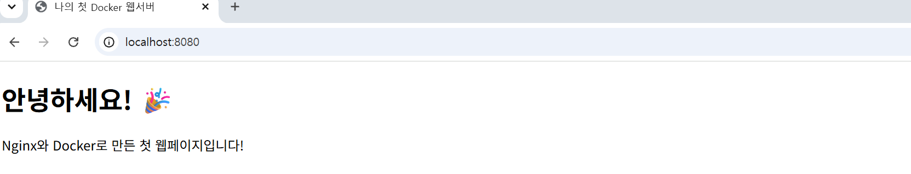
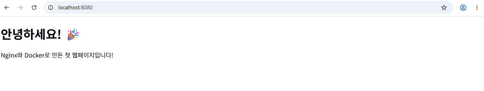
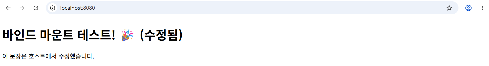

# Docker Nginx 웹서버 실습

## 프로젝트 소개
Docker를 사용해 Nginx 웹서버를 컨테이너화하는 실습입니다.

## 실행 방법

### 1. 이미지 빌드
```bash
docker build -t my-web:latest .
```

### 2. 컨테이너 실행
```bash
docker run -d -p 8080:80 my-web:latest
```

### 3. 접속
브라우저에서 http://localhost:8080 접속

## 실행 결과


## 사용 기술
- Docker
- Nginx
- HTML

## 실행 환경

| 항목 | 버전 |
|------|------|
| Docker | 29.9.2 (build a82e528) |
| Git | 2.56.0.windows.4 |
| OS | Windows + WSL2 |
| 셸 | PowerShell |

## Docker 운영/검증 로그

### 1. 버전 확인
```
docker --version
Docker version 29.9.2, build a82e528

git --version
git version 2.56.0.windows.4
```

### 2. 이미지 목록 (docker images)
```
IMAGE                ID             DISK USAGE   CONTENT SIZE
hello-world:latest   c567b231f656       25.9kB         9.49kB
my-web:latest        dfde7c175559        241MB         63.9MB
ubuntu:latest        6a06111c3b0a        163MB         45.9MB
```

### 3. 컨테이너 목록 (docker ps -a)
```
CONTAINER ID   IMAGE         STATUS                      PORTS                    NAMES
b5a40d7b8ea9   ubuntu        Exited (0) 14 minutes ago                            vibrant_chatterjee
0938b6d39afd   hello-world   Exited (0) 18 minutes ago                            nervous_archimedes
478e77892843   my-web        Up 24 minutes               0.0.0.0:8080->80/tcp     web-bind
```

> 📌 **읽는 법**
> - `web-bind`: Nginx 웹서버, **실행 중(Up)** → localhost:8080 접속 가능
> - `hello-world`, `ubuntu`: 테스트용, 실행 후 **정상 종료(Exited 0)**
## 트러블슈팅

### 바인드 마운트 시 경로 인식 문제

**문제**
Windows PowerShell에서 바인드 마운트로 컨테이너를 실행할 때,
로컬 경로가 제대로 전달되지 않아 파일이 마운트되지 않는 현상이 발생했다.

**원인**
Linux/Mac 방식의 경로 표기(`$(pwd)`)가 Windows PowerShell에서는
그대로 동작하지 않기 때문이다.

**해결**
PowerShell 환경에 맞는 경로 변수(`${PWD}`)로 수정하여 해결했다.

```powershell
docker run -d -p 8080:80 -v ${PWD}/app:/usr/share/nginx/html --name web-bind my-web:latest
```

마운트 후, 로컬 `app/index.html`을 수정하면
브라우저 새로고침 시 **실시간으로 반영**되는 것을 확인했다.
## 🔄 바인드마운트 실시간 반영 테스트

파일을 수정하면 컨테이너 재시작 없이 바로 반영됩니다!

**수정 전**


**수정 후**

